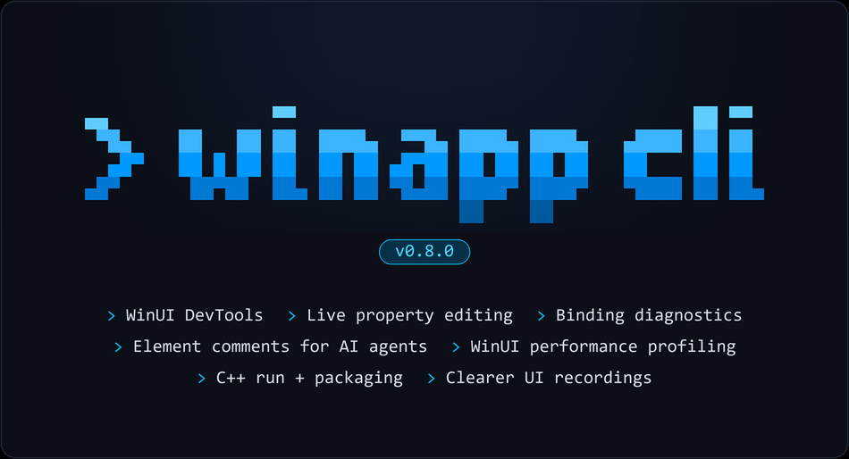

# Windows App Development CLI v0.8: WinUI DevTools, performance profiling, C++ project support, and more



Windows App Development CLI v0.8.0 is here, and we're excited to share the new features WinApp CLI has to offer. Here are the highlights:

- **WinUI DevTools:** Pick an element, inspect its properties and layout, try a change live, leave a comment for your coding agent, or change app theme all from the live DevTools running alongside your app.
- **Performance profiling:** which can record WinUI activity and investigate expensive XAML parsing, layout, and rendering work from the terminal.
- **C++ project support.** Build and run a `.vcxproj`, or build and package it into an MSIX.

Update to the latest release with `winget install Microsoft.WinAppCLI`, or head to [the repo](https://github.com/microsoft/winappCli) for npm and other install options.

Here's an overview of what the new version has to offer.

## ⛏️New WinUI DevTools

With WinUI DevTools, you can inspect controls, experiment with property values, and leave feedback without leaving your running app.

To get started, run this from your WinUI project directory:

```powershell
winapp run .
```

Your app opens with a DevTools toolbar in a corner. Choose **Select element**, then click a control. The DevTools window opens beside your app with the selected element, its place in the visual tree, and its properties, bindings, and layout.

**[DEMO VIDEO: Launch a WinUI app with `winapp run .`, open the element picker, and select a button. Show the matching visual-tree row, property pane, layout information, and XAML source location.]**

DevTools supports WinUI 3 apps written in C# and C++. It starts by default for supported WinUI projects launched with `winapp run`. It doesn't start by default in CI or Windows Sandbox. To turn it off for a run, use `winapp run . --devtools off`.

### View your app's Visual Tree

The visual tree shows how the running UI is put together. Select **Just my XAML** to keep the focus on elements you authored, rather than all the framework elements inside a control's template. Click the text inside a button, for example, and DevTools selects the control from your XAML.

When DevTools can confirm an element against your project, it shows the XAML file and line where it's declared. That gives you a path from "this is the thing I want to change" to the source that defines it, without searching for every matching label in the project.

**[PHOTO]**

### Test out property changes

Expand a property in the inspector to edit its value and see the result in your running app. Try a different width, adjust spacing, or change a brush while keeping the surrounding UI in view.

The property pane also helps explain where the current value comes from. A value set on the element, supplied by a style, or resolved from a resource can lead you to different places in your source. For resource-backed properties, you can try **ThemeResource** or **StaticResource** references, with suggestions for compatible keys available to that element.

**[DEMO VIDEO: Select a control with unexpected spacing. Inspect Margin and Padding, try a new value, then try a compatible brush resource. Show the app updating beside the inspector.]**

These edits are live experiments, not source edits. They disappear when the app restarts. Once you've found the value you want, update your app's XAML and rebuild to keep it. Replacing a bound value can also replace the binding for that run, so treat an edit as an experiment rather than a permanent fix.

### Leave comments for your coding agent

Sometimes the fastest way to explain a change is to point at it.

Choose **Comments** on the toolbar, click an element, and type a note such as "Change this label to Save changes". Save it, and a marker stays on the element.

Your agent can then read the feedback:

```powershell
winapp devtools comments list
winapp devtools comments get cmt_example
```

Replace `cmt_example` with an ID from the list. A comment carries context about the selected element. The agent can check the source match, make the change, and mark the comment resolved:

```powershell
winapp devtools comments update cmt_example --status resolved --note "Updated the label"
```

Comments are saved with the project and can be read after the app closes.

### Agent access to DevTools

The `winapp devtools` commands let you or your agent inspect the live tree, search for elements, read their source and properties, and try changes directly from your command-line:

```powershell
winapp devtools inspect
winapp devtools search Save
winapp devtools get-source SaveButton
winapp devtools get-property SaveButton Width
winapp devtools set-property SaveButton Width 200
```

Use the selector returned by inspection or a unique element name, and add `-a <pid>` when more than one app has DevTools. Add `--json` for structured output that a script or coding agent can work with.

`winapp devtools` complements `winapp ui.` Use UI Automation to interact with an app as a user would, and use DevTools to look inside its WinUI elements, properties, and XAML.

See the [DevTools guide](https://github.com/microsoft/winappCli/blob/main/docs/guides/devtools.md) for the full workflow, including headless operation. The [advanced guide](https://github.com/microsoft/winappCli/blob/main/docs/guides/devtools-advanced.md) covers attaching to an existing app and explicitly enabling DevTools in Windows Sandbox.

## 📈Find expensive work with performance profiling

When a page takes too long to open, you need to know where the time went. The new `winapp perf` commands record WinUI activity through ETW, Windows' event tracing system, and turn it into reports you can query from the terminal.

Start a recording as you launch the project:

```powershell
winapp run . --profile .\traces\navigation --detach
```

Navigate through the scenario you want to investigate, then stop the recording with the capture ID returned by `run`:

```powershell
winapp perf stop CAPTURE_ID
winapp perf analyze .\traces\navigation
```

The report includes process resource usage and observed UI-thread activity, with views for expensive XAML resources, layout operations, elements, and frame intervals. For .NET apps, recorded garbage-collection information can help you investigate overlap with a slow operation.

Drill into the evidence rather than treating every slow frame as the same problem:

```powershell
winapp perf analyze .\traces\navigation --view parsing
winapp perf analyze .\traces\navigation --view hotspots --min-frame-ms 16.67
```

By default, recording starts after launch and can miss early startup. Add `--profile-mode elevated` to record from launch; Windows asks for administrator approval for the recorder, while your app still runs under your normal account. Profiling is local-only, and its UI-thread timings aren't measurements of GPU execution or displayed frame rate.

See the [WinUI performance guide](https://github.com/microsoft/winappCli/blob/main/docs/guides/winui-performance.md) for recording limits, startup capture, and interpreting the results.

## ⚙️Build, run, and package C++ projects

The project workflow now includes Visual Studio C++ projects. Point `winapp run` at a `.vcxproj`, and it builds with Visual Studio's MSBuild before launching the app with package identity:

```powershell
winapp run .\MyApp.vcxproj
```

You can also build and create an MSIX, the Windows app package format, directly from the project:

```powershell
winapp package .\MyApp.vcxproj --cert .\devcert.pfx
```

The same command takes your C++ project from source to a signed package. You'll need Visual Studio or its Build Tools with the C++ components required by your project, including the WinUI tools for a C++ WinUI app. See [C++ project support](https://github.com/microsoft/winappCli/blob/main/docs/usage.md#c-projects-vcxproj) for prerequisites and options.

## 🆔Run separate checkouts side by side

Working on two branches of the same packaged app can mean one registration replaces the other. The new `--unique-identity` option gives each checkout its own package identity, the name Windows uses to distinguish installed packages:

```powershell
winapp run .\checkout-a\MyApp.csproj --unique-identity
winapp run .\checkout-b\MyApp.csproj --unique-identity
```

That lets you compare a change against another branch, or keep parallel coding-agent work from replacing the other checkout's app registration. See [unique identity for parallel checkouts](https://github.com/microsoft/winappCli/blob/main/docs/usage.md#unique-identity-for-parallel-checkouts) for details.

## 📷Make recordings easier to follow

UI recordings now include WinUI menus, flyouts, and tooltips. Add `--cursor` to show the mouse pointer and a short highlight for each click:

```powershell
winapp ui record -a MyApp --cursor --duration-sec 20 --output .\demo.mp4
```

That makes a walkthrough easier to follow when the important action happens in a menu or depends on where someone clicked.

## Other notable changes

- **Better sample discovery**: `find-ui` searches control descriptions and recognizes more ways to ask for controls, including table, data-grid, and spreadsheet queries.
- **More precise UI actions**: click and hover at explicit coordinates, scroll horizontally, and use type or class-name filters without a text query.

## 🐛Bug fixes

- Fixed `winapp ui` hanging when inspecting WinUI 3 apps that contain a WebView2.
- Fixed duplicate builds of referenced projects that could cause packaging failures.
- Improved targeting and recovery guidance for minimized windows and hosted apps.
- Fixed signing to use the hash algorithm a package was built with.
- Fixed template selection when another installed template pack also uses the name `reactor`.

## 🔒Security and infrastructure

This release also tightens DLL loading for the CLI and its diagnostic tools, updates cryptography dependencies, and adds benchmarks for agent-assisted app development and UI automation.

## Get started today

Try inspecting a control, leaving a comment, or profiling a slow page in your own project. Share what you find in the [GitHub repository](https://github.com/microsoft/winappCli).

**Install via WinGet:**

```powershell
winget install Microsoft.WinAppCLI
```

**Install via npm:**

```powershell
npm install --save-dev @microsoft/winappcli
```

Happy building!
