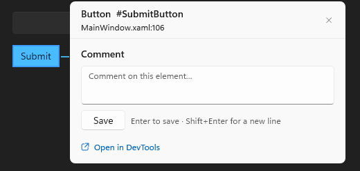
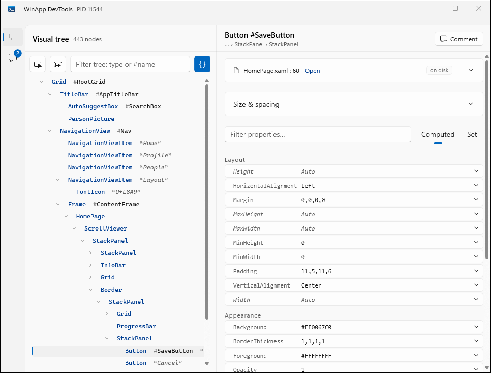

# Inspect a WinUI app with DevTools

DevTools lets you inspect a running WinUI 3 app, try live property changes, diagnose
bindings, and leave comments on elements for an agent to turn into code changes. For
Sandbox, attaching to a running app, query targeting, comment storage, the protocol
and troubleshooting, see [Advanced DevTools](devtools-advanced.md). Every command's
`--help` lists its options and examples. For an app built with Microsoft.UI.Reactor, see
[Inspect a Reactor app](devtools-reactor.md).

The DevTools window needs Windows App SDK 1.7 or later. In an app that uses an older
version, the window doesn't open, and DevTools shows a message that names the required
version.

## Get started

1. From your WinUI project directory, build and launch the app:

   ```powershell
   winapp run .
   ```

   The app opens with the DevTools toolbar in a corner. The command waits for the app;
   cancelling it stops the app it launched.

2. Select **Comments** on the toolbar, then click an element in your app. The comment
   panel opens next to it, showing where the element is declared.

   

3. Type a note and save it. A **Comment saved** notice appears and the comments count
   goes up. To comment on another element, click it: what you typed is saved and the
   panel moves.

4. To inspect an element, select **Select element** and click it. The DevTools window
   opens beside your app with the element tree, properties, bindings and layout.

   

   Click anywhere in a property's header, such as **Height Auto**, to expand or
   collapse it. With the keyboard, Tab to the header and press Enter or Space.
   Tab again to reach its editors; editing does not collapse the property.

5. Ask your agent to read the comments and make the changes:

   ```powershell
   winapp devtools comments list
   ```

### Turn DevTools on or off

`winapp run` starts DevTools for a WinUI project: a `.csproj` with `UseWinUI`, or a
C++ `.vcxproj` that uses the Windows App SDK and has XAML pages. It prints one line
saying so and how to turn it off. It doesn't start DevTools in CI (when `CI` is set),
with `--no-launch`, `--without-alias`, `--profile` or `--on sandbox`, or for a build-output folder,
a .NET file-based app or a project that isn't WinUI.

For one run, pass `--devtools on`, `--devtools headless` or `--devtools off`.
`headless` draws nothing in your app until you press **Ctrl+Shift+F12**; `winapp
devtools` commands still work. With `dotnet run` and the
`Microsoft.Windows.SDK.BuildTools.WinApp` package, use an MSBuild property:

```powershell
dotnet run -p:WinAppRunDevTools=off      # or headless, or on
```

To change the default for your user account (the toolbar's **⋯** menu changes the
same setting):

```powershell
winapp config set run.devtools off    # or headless, or on
winapp config unset run.devtools      # back to the default, on
```

If DevTools can't start in a run where you didn't pass `--devtools`, the app runs
without it and winapp says why; with `--devtools on` or `headless`, that's an error.
For a known WPF-only or Windows Forms-only project, `--devtools on` or `headless`
fails before launch: DevTools requires WinUI 3. Use `winapp run . --devtools off`
to run it without DevTools. Apps that host WinUI alongside another framework and
targets whose framework isn't known are still checked when DevTools attaches.

With `--devtools on` or `headless`, `run` checks the required DevTools engine before
closing a running app for the replacement launch ([details](../usage.md#run)). If
that check fails, the running app stays open and no replacement starts. Without
`--devtools`, the normal replacement launch continues without DevTools.

## Use the toolbar

- **Select element** shows the element you click in the DevTools window, then turns
  picking off. Your next click reaches the app. Select **Select element** again to
  inspect another element, or press **Esc** before picking to cancel.
- **Comments** opens the comment panel on the element you click. It shows where the
  element is declared: its XAML file and line, or a Reactor element's C# call site.
- Clicking a control's template part or generated text selects the control from your
  XAML; turn off **Just my XAML** in the DevTools window to pick the parts themselves.
  In a Reactor app the toggle is named **Just my code** and keeps you on elements your
  C# created.
- Saved comments show as markers on their elements; the arrow beside **Comments**
  lists them and hides or shows the markers.
- **Ctrl+Shift+F12** brings back a hidden toolbar; **⋯** hides it, keeps it open, or
  sets what happens when the app starts.
- In a [Reactor app](devtools-reactor.md), a red count shows render errors and keyed-list
  warnings since launch, and **Highlight updates** outlines components as they re-render.

- When collapsed, the toolbar reads **DevTools**. It reads **Picking** or **Commenting** while that mode is on,
  because then your clicks go to DevTools instead of the app.
- `winapp ui screenshot` leaves the toolbar, markers and comment panel out of the image.

In the **Visual tree**, press **Tab** to enter the tree, then **Up arrow** or
**Down arrow** to move between rows. **Enter** or **Space** selects a row.
**Right arrow** expands a collapsed row or moves to its first child.
**Left arrow** collapses an expanded row or moves to its parent.
Press **Tab** again to leave the tree.

While the tree filter contains text, all matching rows stay visible and expansion
is disabled. Clear the filter to expand or collapse rows again.

In a property's resource-key editor, type part of a key, then click a suggestion
or choose it with **Down arrow** and **Enter**. Choosing fills the field without
changing the app. Press **Enter** again or select **Apply** to assign the resource.

## Review comments with an agent

```powershell
winapp devtools comments list
winapp devtools comments get cmt_example
winapp devtools comments update cmt_example --status resolved --note "Updated the label"
```

`list` shows open comments (`--all` adds resolved, stale and dismissed ones; `--json`
includes every status). It reads the project's comment store, so the app doesn't need
to be running. `get` shows the captured declaration and where it matches your source
now, and for a live element, its style and brushes with their resource keys, so a
request like "make this warmer" leads to the resource to change.

A match is confirmed when the declaration or `x:Name` matches exactly one place,
including after lines move. Otherwise `get` lists ranked candidates: confirm the
intended one before editing. A comment marked **Not linked to source** (`weak` and
`requiresConfirmation` in `--json`) has no source location; search the project for its
`x:Name`, AutomationId or text. A comment on a Reactor element is anchored to its C# call
site; see [Comments on Reactor code](devtools-reactor.md#leave-comments-on-reactor-code).

The agent should verify the location, make the change, and resolve the comment after
checking the result. If the element can't be confirmed, mark it stale instead of
guessing:

```powershell
winapp devtools comments update cmt_example --status stale --note "Element moved"
```

Every change to a comment refreshes the markers in your running DevTools apps.

## Find and inspect an element

```powershell
winapp devtools inspect
winapp devtools search Save
winapp devtools get-property SaveButton Content
winapp devtools get-source SaveButton
winapp devtools diagnose-binding SaveButton Content
winapp devtools set-property SaveButton Width 200
```

Copy the selector printed in brackets, such as `button-savebutton-a1b2c3d4e5`,
or a number like `42`, into another command.

You can also type an `x:Name` or AutomationId (the same one `winapp ui` uses).
If it matches more than one element across those two identities, the command
fails and lists selectors to use instead. When more than one app has DevTools,
add `-a <pid, name or title>`.

`inspect` and `search` show where each element is declared, such as
`MainWindow.xaml:37`, when DevTools can confirm it against your source. They show your
own XAML and Reactor code; add `--all` for framework and control-template elements. `search` matches
text, type, `x:Name`, AutomationId and file. To filter by property, use `--of-type`
and `--with`:

```powershell
winapp devtools search --of-type TextBlock --with 'FontSize>=20' --fields 'Text,FontSize'
```

`set-property` reports the value before and after. Changes are live only: they don't
edit your source and are gone when the app restarts. Setting a bound property replaces
its binding until you restart the app; the output warns you. `diagnose-binding` shows
what a binding resolves to; add `--json` for every observation.

For a brush, pass a fixed color, such as
`winapp devtools set-property SaveButton Background '#FF0067C0'`.
The CLI does not create `{ThemeResource key}` or `{StaticResource key}` references.
To change the reference permanently, edit the XAML and rebuild the app.

In the inspector, choose **ThemeResource** or **StaticResource** in the property's
kind list to try a resource on the running app. Type a key, such as `BBAccentBrush`;
suggestions include compatible resources from the selected element, its parents,
and the app, including merged and active-theme dictionaries. Choose a suggestion
or finish typing, then press Enter to apply it. If the key cannot be applied, the
error appears beneath the field and says whether the previous value was restored.
Correct the key or resource type and try again. If a previous value could not be
restored, set the property again. You can still type a key when suggestions are
unavailable or incomplete.

To try a regular binding in the inspector, choose **Binding**, enter a path such as
`Title`, choose its mode, then select **Replace entire binding**. The editor uses
the installed binding's path when you return to the element. Replacing an `x:Bind`
(a binding compiled into app code) is temporary: generated updates can overwrite
the replacement.

After a live edit overrides a binding, use **Restore binding** to reattach the
captured regular binding. For compiled bindings, Restore asks before reapplying
**all compiled bindings on the same owner**, such as the page. This can overwrite
other live edits. Select **Re-apply all compiled bindings** to continue, or
**Cancel** to leave the bindings unchanged. Neither action undoes source-model
changes or edits your XAML.

DevTools hides passwords: it shows them as `<redacted>` and refuses to set them. It hides:

- a property whose name ends in `Password`, and in a [Reactor app](devtools-reactor.md) a
  prop, hook or context with such a name
- in a Reactor app and in binding diagnoses, a value whose type has a public field or property
  whose name ends in `Password`, such as `record Login(string User, string Password)` or a
  `List<Login>`
- in a Reactor app, a hook your C# passes directly to a `PasswordBox`
- in source previews and comments, password values in your XAML and the text values on a
  line of C# that mentions a password

A password passed through your own wrapper component is shown. For example, with
`SecretField(pwd, setPwd)`, where `SecretField` renders a `PasswordBox`, `get-state` shows
`pwd`'s value unless the variable or the parameter name ends in `Password`.

For a terminal you keep using, launch with `winapp run . --detach`: it prints the PID
and the next command. For scripts, add `--json`; see
[JSON output](devtools-advanced.md#json-output).

## Keep DevTools attached while you edit

```powershell
winapp run . --watch
```

`--watch` runs your project under `dotnet watch`. Edits that .NET Hot Reload can apply
change the running app, and DevTools stays attached. When an edit needs a restart,
`dotnet watch` rebuilds and relaunches the app, and DevTools attaches to the new
process in the same mode (`on` or `headless`):

```text
✅ The app restarted (PID 27376); DevTools attached again.
```

This works for unpackaged projects with the .NET 8 SDK or later, and for packaged
projects with the .NET 9 SDK or later. A packaged app is
registered again and relaunched with its package identity on each restart, so it keeps
its DevTools and Hot Reload connection; this needs the app's execution alias to be
enabled, as `winapp run` with DevTools already does. `dotnet watch` doesn't watch `.xaml`
files by default, so after editing XAML, save a C# file or press Ctrl+R in the
terminal to restart.

Press Ctrl+C to stop `dotnet watch` and the app. `--watch` needs DevTools on (the default for a
WinUI project) or `--devtools headless`, and can't be combined with `--devtools off`,
`--detach`, `--json`, `--debug-output`, `--no-build`, `--aot`, `--clean`,
`--unregister-on-exit` or `--on sandbox`.

To pass arguments to your app, put them after `--`:

```powershell
winapp run . --watch -- --my-flag value
```

## When something fails

| What you see | What to do |
|---|---|
| `DevTools unavailable: …` on a default run | The app ran without DevTools; the line says why. Fix the cause, or pass `--devtools on` to make it an error. |
| The app is already running and couldn't be closed | Close it and run again, or [attach to its PID](devtools-advanced.md#attach-to-an-app-that-is-already-running). |
| The toolbar doesn't appear, or reports a missing XAML resource | Merge `XamlControlsResources` into your app's resources (standard templates do); until then use `--devtools headless`. See [visual UI prerequisites](devtools-advanced.md#visual-ui-prerequisites). |
| Launch fails on the execution alias | Turn the app's entry on in **Settings > Apps > Advanced app settings > App execution aliases**. |
| DevTools can't launch the app through its alias | The alias starts a launcher. Start the app through it and attach; see [an app whose alias starts a launcher](devtools-advanced.md#an-app-whose-alias-starts-a-launcher). |
| The DevTools engine is missing | Reinstall winapp; keep its files together. |
| Access denied when attaching | Run winapp as the app's user, at the same or higher integrity. |

More cases are in [Advanced DevTools](devtools-advanced.md#troubleshooting).
