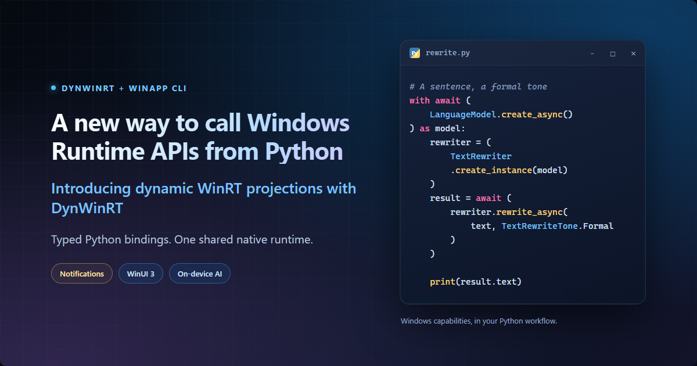
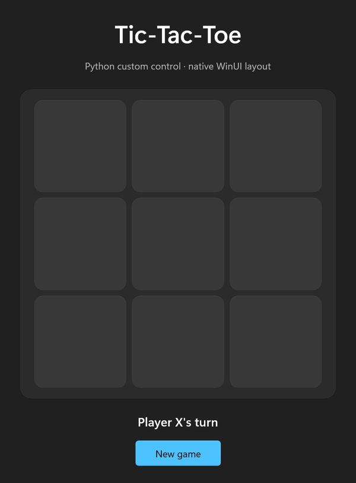

# A new way to call Windows Runtime APIs from Python

*Introducing dynamic WinRT projections with DynWinRT.*



Python is a natural fit for automation, desktop tools, and AI workflows. But adding a Windows-native capability can introduce a native build pipeline. If available Python packages do not expose the API you need, whether it comes from a newer Windows App SDK or your own WinRT component, you may need to generate and compile native bindings, then build wheels for the Python versions and architectures you support.

DynWinRT's dynamic Windows Runtime (WinRT) projection takes a different approach. Generate typed Python bindings from Windows Runtime metadata (`.winmd` files), then use a shared, prebuilt runtime to make the native calls. Your application works with constructors, snake_case members, type hints, and `asyncio`, while the generated bindings remain Python code.

## What makes this projection different

DynWinRT separates the generated API surface from the native calling machinery:

- **Generate Python, not API-specific native extensions.** Codegen emits `.py` modules and `.pyi` type stubs from metadata describing API types and method signatures.
- **Reuse one native runtime.** The shared runtime handles supported calls across the generated API packages; each package does not need its own compiled binding extension.
- **Extend the API surface through metadata.** Select compatible Windows SDK, Windows App SDK, or custom WinRT APIs and regenerate the bindings as your needs change.

## How the pieces fit together

The Python projection is delivered through three packages on PyPI. Install `winapp-cli` to get the `winapp-py` command; it coordinates binding generation and installs the matching runtime version for your project:

- [**`winapp-cli`**](https://pypi.org/project/winapp-cli/) prepares the SDK metadata and app manifest, generates bindings, and handles development package identity.
- [**`dynwinrt-codegen`**](https://pypi.org/project/dynwinrt-codegen/) reads `.winmd` metadata and generates Python modules with matching type stubs (`.py` + `.pyi`).
- [**`dynwinrt`**](https://pypi.org/project/dynwinrt/) is the shared, prebuilt Windows x64 and ARM64 runtime that invokes supported Windows APIs when your application runs.

Together, these packages turn Windows Runtime metadata into typed Python APIs that your application can import and call.

## Three Windows experiences in Python

The examples below show a Windows notification, explore a richer XAML interface, and rewrite text with Windows AI.

Use Windows 11 with CPython 3.11-3.14 x64 or ARM64. Install the CLI's Python package:

```powershell
python -m pip install winapp-cli
```

### 1. Show a Windows notification

Display a native Windows notification from a Python script. This example runs unpackaged.

Create and initialize a new notification project:

```powershell
New-Item -ItemType Directory -Path "$HOME\python-notification-demo"
Set-Location "$HOME\python-notification-demo"
winapp-py init . --use-defaults --add-python-bindings
```

`winapp-py init` prepares the Windows SDK and Windows App SDK inputs, then generates the default supported, non-UI Windows App SDK bindings.

Save this as `notification.py` in `python-notification-demo`:

```python
import os
from pathlib import Path
import sysconfig

from dynwinrt import RoApartment, init_winappsdk
from winapp_bindings import AppNotificationBuilder, AppNotificationManager


def main() -> None:
    arch = {"win-amd64": "x64", "win-arm64": "arm64"}[sysconfig.get_platform()]
    os.environ["WINAPPSDK_BOOTSTRAP_DLL_PATH"] = str(
        Path(__file__).resolve().parent / f".winapp\\bin\\{arch}\\Microsoft.WindowsAppRuntime.Bootstrap.dll"
    )
    runtime = init_winappsdk(2, 5)
    try:
        with RoApartment():
            if not AppNotificationManager.is_supported():
                raise RuntimeError("Windows app notifications are not supported")

            manager = AppNotificationManager.get_default()
            manager.register()
            try:
                notification = (
                    AppNotificationBuilder()
                    .add_text("Hello from Python")
                    .add_text("This is a native Windows notification.")
                    .build_notification()
                )
                manager.show(notification)
                if notification.id == 0:
                    raise RuntimeError("Windows did not assign a notification ID")
            finally:
                manager.unregister()
    finally:
        del runtime


if __name__ == "__main__":
    main()
```

Run the script:

```powershell
winapp-py run .\notification.py
```

Run the script to display a Windows notification.

### 2. Build a native WinUI interface

WinUI 3 lets you build a native Windows interface in Python, with or without XAML. Define the layout in XAML and handle events in Python, or create and arrange the controls directly in Python.

The Tic-Tac-Toe samples demonstrate both approaches:

- **XAML and Python:** [WinUI Tic-Tac-Toe](https://github.com/microsoft/dynwinrt/tree/main/samples/python/winui-tic-tac-toe) defines the interface in XAML, with Python handling events and game logic.
- **Python-only UI:** [Code-only Tic-Tac-Toe](https://github.com/microsoft/dynwinrt/tree/main/samples/python/winui-tic-tac-toe-code-only) creates the controls and layout in Python, without a XAML file.

Both use the generated WinUI bindings and keep the application logic in Python. The animation below shows the XAML version.



### 3. Rewrite text with on-device AI

[Windows AI text rewriting](https://learn.microsoft.com/en-us/windows/ai/apis/phi-silica#text-intelligence-skills) can change the tone of a sentence. This example uses `LanguageModel` and `TextRewriter` to rewrite a short sentence in a formal tone.

Use a supported Copilot+ PC and enable Developer Mode for development identity. The linked Windows AI guide describes model availability and hardware requirements.

Create and initialize a separate project:

```powershell
New-Item -ItemType Directory -Path "$HOME\python-text-rewrite"
Set-Location "$HOME\python-text-rewrite"
winapp-py init . --use-defaults --add-python-bindings
```

Save this complete program as `rewrite.py`:

```python
import asyncio

from dynwinrt import RoApartment, has_package_identity
from winapp_bindings import (
    AIFeatureReadyResultState,
    AIFeatureReadyState,
    LanguageModel,
    LanguageModelResponseStatus,
    TextRewriter,
    TextRewriteTone,
)


TEXT = "WinApp CLI makes it easier to use Windows APIs from Python."


async def rewrite(text: str) -> str:
    if not has_package_identity():
        raise RuntimeError("Run this example with winapp-py run --identity")
    with RoApartment():
        state = LanguageModel.get_ready_state()
        if state not in (AIFeatureReadyState.Ready, AIFeatureReadyState.NotReady):
            raise RuntimeError(f"Windows AI language model is not ready: {state.name}")
        if state == AIFeatureReadyState.NotReady:
            ready = await LanguageModel.ensure_ready_async()
            if ready.status != AIFeatureReadyResultState.Success:
                raise RuntimeError(f"Language model preparation failed: {ready.status.name}")

        with await LanguageModel.create_async() as model:
            rewriter = TextRewriter.create_instance(model)
            try:
                result = await rewriter.rewrite_async(text, TextRewriteTone.Formal)
                if result.status != LanguageModelResponseStatus.Complete:
                    raise RuntimeError(f"Text rewriting failed: {result.status.name}")
                if not result.text.strip():
                    raise RuntimeError("Windows AI returned empty rewritten text")
                return result.text
            finally:
                del rewriter


def main() -> None:
    print(asyncio.run(rewrite(TEXT)))


if __name__ == "__main__":
    main()
```

Before running, make sure `Package.appxmanifest` includes the following Windows AI declarations, lists `systemai` in `IgnorableNamespaces`, and uses the `MaxVersionTested` value shown below.

`Package` opening tag:

```xml
xmlns:systemai="http://schemas.microsoft.com/appx/manifest/systemai/windows10"
```

`Capabilities`:

```xml
<systemai:Capability Name="systemAIModels" />
```

`Dependencies` (retain your existing `MinVersion`):

```xml
<TargetDeviceFamily Name="Windows.Desktop" MinVersion="10.0.18362.0" MaxVersionTested="10.0.28000.0" />
```

Run with development identity:

```powershell
winapp-py run --identity .\rewrite.py
```

The script prints the sentence rewritten in a formal tone.

#### Package and share the rewrite app

When you're ready to share your text-rewriting tool, package it as an installable Windows app. PyInstaller bundles Python, `rewrite.py`, DynWinRT, and the generated bindings. WinApp CLI turns that directory into an MSIX, a Windows application package.

Run the following commands from `python-text-rewrite`, keeping the Windows AI capability and matching Windows App Runtime dependency in that project's `Package.appxmanifest`.

**1. Bundle Python, DynWinRT, and the generated bindings.**

```powershell
python -m pip --python .\.venv\Scripts\python.exe install PyInstaller
.\.venv\Scripts\python.exe -I -B -m PyInstaller `
    --clean --noconfirm --onedir --name PythonTextRewrite `
    --paths .\.winapp\python `
    --collect-all dynwinrt --collect-submodules winapp_bindings `
    .\rewrite.py
```

**2. Add a command-line alias and create a signed development package.**

```powershell
winapp-py manifest add-alias --name python-text-rewrite-demo.exe --manifest .\Package.appxmanifest
winapp-py cert generate --manifest .\Package.appxmanifest --output .\devcert.pfx
winapp-py package .\dist\PythonTextRewrite --manifest .\Package.appxmanifest `
    --executable PythonTextRewrite.exe --cert .\devcert.pfx --output .\dist\PythonTextRewrite.msix
```

**3. Trust the development certificate from Administrator PowerShell.**

```powershell
winapp-py cert install .\devcert.pfx
```

**4. Install the app.**

Return to normal PowerShell to install the package:

```powershell
Add-AppxPackage .\dist\PythonTextRewrite.msix
```

The development certificate is for local testing. Keep its PFX file private and out of source control. For distribution, use release signing, include bundled dependencies' license notices, and validate the final package on target devices.

## Add another API when you need it

To use another compatible API, add its entry-point class to the project's `types` list and regenerate the bindings:

```powershell
winapp-py generate
```

For your own WinRT component, place its `.winmd` files inside the project and update `additional-winmds` and `additional-refs` in the existing bindings table. The paths below illustrate a component you supply:

```toml
additional-winmds = [
    { winmd-path = 'metadata\Vendor.winmd', namespace = "Vendor.Component", classes = ["Thing"] },
]
additional-refs = ['metadata\Dependency.winmd']
```

Use paths to existing local files, then regenerate after changing the metadata inputs. Generating bindings does not deploy the component: its binaries, activation, and capabilities still need to be configured. The [Python codegen guide](https://github.com/microsoft/dynwinrt/blob/main/tools/dynwinrt-codegen/python/README.md) covers API selection and reference metadata in more detail.

## Feedback and resources

Tell us where using Windows APIs from Python could work better: an awkward API name, an unexpected type hint or `asyncio` behavior, a difficult setup step, or a scenario you want to build. Concrete examples help us improve the bindings and tooling.

### Where to file issues

WinApp CLI and DynWinRT live in separate repositories. Choose the issue tracker that matches the problem:

- [WinApp CLI issues](https://github.com/microsoft/winappCli/issues): CLI installation, SDK restore, project configuration, development identity, CLI documentation, or the examples in this article.
- [DynWinRT issues](https://github.com/microsoft/dynwinrt/issues): the shared runtime, code generation, API and type mapping, generated Python modules and type stubs, or projected `asyncio` behavior.

### WinApp CLI

- [Repository](https://github.com/microsoft/winappCli) and [command reference](https://github.com/microsoft/winappCli/blob/main/docs/usage.md)
- [Install `winapp-cli` from PyPI](https://pypi.org/project/winapp-cli/) to get the `winapp-py` command
- [Python workflow guide](https://github.com/microsoft/winappCli/blob/main/docs/guides/python.md)

### DynWinRT (the projection itself)

- [Repository](https://github.com/microsoft/dynwinrt)
- [Python runtime guide](https://github.com/microsoft/dynwinrt/blob/main/bindings/py/README.md) and [codegen guide](https://github.com/microsoft/dynwinrt/blob/main/tools/dynwinrt-codegen/python/README.md)
- [Python samples](https://github.com/microsoft/dynwinrt/tree/main/samples/python) and [runnable examples for this article](samples/python-projections-blog/README.md)

We'd like to hear what you build and which Windows API you want to use next.
