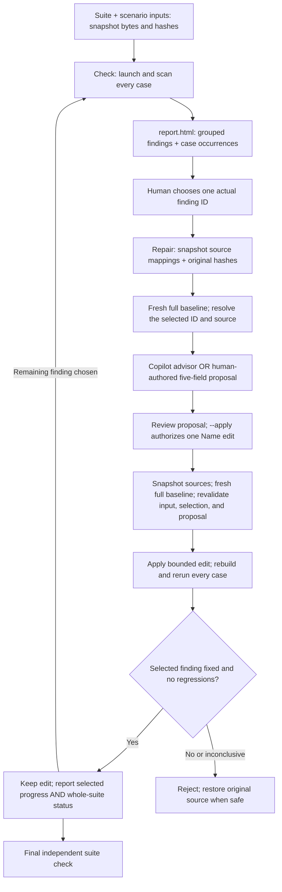

# AccessLoop: inspect a page and verify workflow repairs

## Use the local WinAppCLI bundle

The [local bundle guide](local-bundle.md) runs the existing accessibility
workflows through `winapp ui accessibility`, with the managed engine and its
runtime included beside the native CLI. It also includes the project skill and
StateDemo sources. The repository-runner examples below remain useful for
development; the bundle does not require that runner to be installed separately.

## Run the preset inspection, reproduction and repair loop

Use the [complete state-demo loop](state-demo-guide.md#run-the-complete-preset-loop)
to inspect a source-owned three-tab app with real keyboard input, an in-memory
switch, dropdown disclosure, body scrolling and an in-window dialog. `loop`
records the executed route, reproduces it in a fresh process, and optionally
asks Copilot for bounded Name-only source repairs before rebuilding and
rechecking the same route. It works in its own source copy and preserves
archived source versions for replay.

The route is preset, not autonomous AI discovery. Rule findings, input delivery,
behavior assertions and partial capture are reported separately. This is a
declared demo workflow, not whole-app WCAG certification.

## Run the short three-page UI-state demo

Use the [state exploration demo guide](state-demo-guide.md) for a small owned
WinUI 3 app with three pages: ordinary controls and a dropdown, finite scrolling
content, and a declared dialog. `explore` audits their approved states with
separate evidence, without selecting settings or applying source repairs.
Present that run live, then use the saved PowerToys survey below as the
existing-app example. Capture completeness and unvisited states stay explicit.

## Test an installed app: PowerToys Settings

Use the [resumable survey guide](survey-guide.md) to audit the already-running
PowerToys Settings app without its source code. The `survey` command uses an
explicit navigation profile, confirms page headings, generates per-page
UIA/Axe/image reports and supports pause/resume and single-page retries.
It does not build, restart, close or change feature settings in the target app.

This is the existing-app closing demonstration. Use `scan` below for a single
page, or the separate source-owned `journey` demo to demonstrate constrained
repairs. They share the automatic page-report format, not app ownership or
permissions.

## Run the multi-page repair demo

The [three-page journey guide](journey-guide.md) walks through a source-owned
WinUI application: discover approved navigation, scan every declared page,
repair the two missing button names one at a time, rebuild and replay the same
frozen routes. The dedicated `winapp-accessloop` skill guides an agent through
that workflow. The journey operates on a disposable source copy, not an
installed application such as PowerToys.

Required repair verification and auxiliary capture completeness are reported
separately. Privacy-withheld metadata stays partial; it does not become a
compliance pass. Missing pages, lost controls, truncation, timeouts and changed
acceptance inputs still block verification.

## Scan a page that is already open

From the repository root, use the native build containing the `ui audit-*`
commands and the PID of an application that is already running:

```powershell
$auditWinapp = (Resolve-Path .\artifacts\cli\win-x64\winapp.exe).Path
$auditRunner = ".\samples\accessloop\AccessLoop"
dotnet run --project $auditRunner -- scan --pid 1234 --winapp $auditWinapp --output .\page-audit
Invoke-Item .\page-audit\report.html
```

The `--project` above builds **AccessLoop**, not the app being inspected. No app
source, scenario file, AutomationId, AI model or Accessibility Insights installation
is required. The application is never built, restarted or closed by `scan`.
Use `--window <HWND>` instead of `--pid` to select an exact window; find handles
with `winapp ui list-windows`. Every output directory must be new.

To discover standard Tab/TabItem controls, select their pages automatically,
and collect a combined report without an agent or page profile, use
[`winapp ui audit`](local-bundle.md#automatically-scan-standard-tab-pages)
from the native local bundle. It traverses supported standard tabs by default;
add `--current-page` to keep the current page instead. Page selection is not the `--tab-steps`
keyboard focus probe below.

If the selected window has visible owned windows, Axe can include their UIA
descendants too. The audit refuses that wider Axe scan rather than silently
expanding scope. Select the dialog's HWND or close its owned windows before
retrying; other available evidence remains in the partial report.

The default run reads a bounded UIA snapshot, executes Axe.Windows, calculates
text contrast where provider attributes are usable, and captures the selected
window without requesting activation or expanding to owned windows. It does not
click, type, scroll, restore a minimized window or alter system settings.
Use `--no-screenshot` when images are unwanted or passive capture is unavailable.

Open `report.html` and start with **本页摘要**, then the issue descriptions and
control images. Each issue's rule IDs, element properties and evidence links
are under **规则、控件与原始证据**. Coverage limits and capture errors remain
visible; normal observations, the full UIA tree, the check catalog and raw
files are collapsed under **证据与技术详情**. Expand them when investigating,
not to determine whether a page passed.

The output directory contains:

- `scan.json`: the automatic results, target identity, implementation catalog and
  artifact hashes. This file is not changed when assessments are attached.
- `snapshot.json`: scan-local node IDs, UIA hierarchy/properties, typed text-range
  attributes, and explicit read errors or truncation.
- `axe.json`: individual Axe failures, preserving their native rule IDs and
  within-scan deduplication. Sensitive Value/text properties are filtered.
- `screenshot.png` and `screenshot.json`, when capture succeeds.
- `snapshot-after-screenshot.json`, when an issue can be linked to a captured
  window image. This second read checks element identity and bounds without
  replacing the original snapshot.
- `report.html`: the readable automatic report, with a separate assessment section.

**Find the affected control visually.** Rule-failure cards and low-contrast
observations include a control crop and a **查看整窗位置** link when the
coordinates can be verified. The numbered window map links back to the relevant
issue. These are views of the same saved PNG, not new screenshots taken after
clicking each control. AutomationIds are not required: matching uses runtime
identity within this run.

The map requires physical frame bounds matching the PNG dimensions, the same
window root, and unchanged control identity/bounds before and after the image;
Axe findings must also have matching bounds. Moved, offscreen, unidentifiable or
unsupported targets show a reason instead of an invented crop. Partially
intersecting controls are labeled as clipped. The snapshots are not atomic, and
visual location is not a visual accessibility judgment. Existing reports without
this evidence cannot acquire reliable markers merely by being reopened.

Raw UIA Value fields and document text are excluded, but screenshots, accessible
names and notifications can still contain user data. Keep evidence local and
inspect it before sharing.

An empty AutomationId is a **testability observation**, not a scan prerequisite
or an accessibility failure. Text contrast uses provider COLORREF values and
font sizes in points; mixed/unsupported/withheld data remains inconclusive.
Below-threshold text in enabled, focusable Edit controls can produce a specific
provider-attribute failure. Other text comparisons remain observations because
content exceptions, such as logos, have not been established.

Exit **0** means the requested capture completed without reported rule failures;
**1** means it completed with rule failures; **2** means it was blocked or partial.
None is a whole-app WCAG verdict. The catalog explicitly lists unsupported and
unrequested checks; it is not an enumeration of every Axe rule or the 55 WCAG
A/AA criteria.

### Add events or a bounded keyboard path

Passive event observation does not inject input:

```powershell
dotnet run --project $auditRunner -- scan --pid 1234 --observe-seconds 5 --winapp $auditWinapp --output .\page-events
```

To authorize real Tab and Shift+Tab input in a disposable test state:

```powershell
dotnet run --project $auditRunner -- scan --pid 1234 --tab-steps 8 --accept-input --observe-seconds 12 --winapp $auditWinapp --output .\page-keyboard
```

`--tab-steps` is the maximum **per direction**, within the total observation-time
budget. Without an explicit observation budget it defaults to 10 seconds when
keyboard input is enabled. A probe can finish with fewer steps because the
deadline or a scope guard stopped it. Even changing focus can trigger app-side
validation or saving; input is opt-in and is not rolled back.

`observation.json` records actual focus paths, repeated targets, received UIA
events, and the reason observation stopped. A repeat is not a keyboard-trap
verdict. A baseline candidate not visited during this limited probe is not
proof of unreachability. Events are not proof of correct screen-reader output.
No AutomationId is needed to record these observations.

### Attach a human or AI assessment without changing automatic findings

Create a template bound to the original scan and evidence:

```powershell
dotnet run --project $auditRunner -- assessment-template .\page-audit\scan.json --author "Reviewer" --output .\page-review.json
```

Fill the entries you are assessing with reasons, supporting evidence and an
appropriate status. Remove untouched template entries rather than importing
blank explanations, then produce a separate combined report:

```powershell
dotnet run --project $auditRunner -- assess .\page-audit\scan.json --assessment .\page-review.json --output .\page-audit-reviewed
Invoke-Item .\page-audit-reviewed\report.html
```

For an AI-authored template, specify `--source ai --model <model-name>` as well
as `--author`. These commands do not call an AI service or upload evidence.
AI suggestions remain distinguished from human confirmations and cannot
overwrite machine findings. Changed scan bytes, modified evidence, invalid
references and unsupported assessment statuses are rejected; create a fresh
assessment for a new scan instead of editing hashes to force a match.

### Capture limits and missing capabilities

`scan` accepts `--depth 1..50` (default 20), `--max-elements 1..10000`
(default 2000), and `--timeout-ms 1000..120000` (default 15000).
`--json` emits a final summary with the report paths, execution status and
automatic scan hash. Provider calls, event support and text attributes vary
by framework, so unavailable data is reported rather than replaced by guessed
values.

The scan does not yet assess image-derived contrast, logical reading order,
effective pointer target sizes, arbitrary control behavior, theme/scale
variants, media equivalence or actual screen-reader output. Those omissions
remain visible in the catalog rather than being counted as passes.

## Scan and repair the included workflows

From the repository root, copy the **whole sample** to a fresh working directory
and scan its two document workflows:

```powershell
Copy-Item .\samples\accessloop .\accessloop-playground -Recurse
$runner = ".\accessloop-playground\AccessLoop"
$suite = ".\accessloop-playground\suite.json"
$winapp = "C:\tools\winapp\winapp.exe"

dotnet run --project $runner -- check $suite --winapp $winapp --output .\accessloop-baseline
Invoke-Item .\accessloop-baseline\report.html
```

Replace `$winapp` with your full path to native **winapp 0.6.0 or newer**.
Destination and output directories must be new. Keep the checked-in XAML
unchanged: it deliberately contains the defects used by the sample tests.

The baseline is expected to exit **1**. Save and Export are two independently
nameless, icon-only buttons visible in the same window. Each scenario's
Axe.Windows scan should report both `NameNotNull` violations. The report groups
these into **two findings**, each affecting both scenarios, rather than four
separate issues. The intended-name assertions fail; keyboard navigation and
each action's status update should already work.

**`report.html` is the workbench.** Choose a finding from its inventory, review a
bounded proposal, repair that one issue, and rerun every case. Its **Action
outcome** and **Whole-suite status** are separate: a successful selected repair
can leave the suite failed. If observations differ from the expected demo,
review the evidence instead of treating unrecognized findings as noise.

AccessLoop is an external .NET runner, not a winapp command or a general-purpose
coding agent. It uses [Axe.Windows](https://github.com/microsoft/axe-windows) for
independent accessibility scans and native winapp for builds, launches, Windows
UI Automation (UIA), real keyboard input, and screenshots.

## Prerequisites

- Windows 10 version 1809 or newer, with an **unlocked interactive desktop**.
  Keep the demo unobstructed and do not type or switch windows during a run.
- .NET 10 SDK. Project restore provides the demo's WinUI/Windows SDK dependencies
  and the runner's pinned **Axe.Windows 2.4.2** package. No separate AxeWindowsCLI
  or Accessibility Insights installation is needed.
- Native winapp >= 0.6.0; no npm wrapper or global installation is needed.
- An authenticated Copilot CLI and an available model **only for AI proposals**.
  `--copilot FULL_EXE` overrides the default `copilot`. The
  [reviewed-proposal path](#use-a-reviewed-proposal-without-ai) never calls AI.

The demo is unpackaged and includes its Windows App SDK runtime
(`WindowsAppSDKSelfContained=true`). It does not register an MSIX package or
install a machine-wide runtime. Save and Export only change a status label.
Each new process starts with `Untitled` and `Not saved yet`; neither action
writes a document or persists preferences.

### Restore through your approved package source

NuGet uses its normal configuration hierarchy. On a restricted network, use an
approved proxy/mirror in a session-scoped configuration rather than changing
shared machine settings. No corporate feed URL is built into this sample.
For an explicit restore:

```powershell
dotnet restore .\accessloop-playground\AccessLoop\AccessLoop.csproj --configfile .\approved.nuget.config
dotnet restore .\accessloop-playground\Demo\AccessLoop.Demo.csproj --configfile .\approved.nuget.config -r win-x64
dotnet build .\accessloop-playground\Demo\AccessLoop.Demo.csproj --no-restore -r win-x64
```

Use `win-arm64` on ARM64. To give winapp's child builds the same sources, put
that configuration at `NuGet\NuGet.Config` inside a disposable directory in
your working folder, and point `APPDATA` there **in a dedicated PowerShell
session**. Keep Copilot authenticated in that session or use a reviewed proposal.
A restore error is an inconclusive execution, not an accessibility finding.

## Choose and repair one finding

In the baseline report, choose the `SaveDocumentButton` finding. Copy its actual
**finding ID**, beginning with `AL-`, not its AutomationId:

```powershell
$saveId = Read-Host "Paste the SaveDocumentButton finding ID from report.html"

# Fresh full baseline, then a proposal. No source edit.
dotnet run --project $runner -- repair $suite --finding $saveId --winapp $winapp --output .\accessloop-save-proposal
Invoke-Item .\accessloop-save-proposal\report.html
```

Review `source-candidates.json`, `proposal.json`, and the baseline evidence.
Check that the proposed **Save document** name describes the button's action.
Exit **3**, `awaiting-approval`, means there is a proposal to review, not a repair.

Findings marked as stable keep their IDs across rebuilds and source-name fixes
in the **same project path**, not across copies to another folder. Each repair
recomputes the inventory from a fresh complete baseline. An old report is useful
for choosing an ID, never as proof that the current app still has that finding.

Without `--finding`, `repair` auto-selects only when there is exactly one
finding. With multiple findings it returns **3**, `awaiting-selection`, with
the inventory and no proposal or source edit.

### Apply the exact proposal you reviewed

```powershell
dotnet run --project $runner -- repair $suite --finding $saveId --proposal .\accessloop-save-proposal\proposal.json --apply --winapp $winapp --output .\accessloop-save-verification
Invoke-Item .\accessloop-save-verification\report.html
```

`--apply` explicitly authorizes one bounded `AutomationProperties.Name` edit.
Source mappings and original hashes are captured before the fresh full baseline.
The selected source file must still match that snapshot before an edit can be
applied, so a source change during the baseline cannot be silently overwritten.
The runner then rebuilds and reruns **both** scenarios with the same scans and
frozen assertions, including cases affected by the selected finding but targeting
another button. The selected control must remain present in every affected
rerun case; disappearance cannot count as a fix.

**Expected result: action `fixed`, suite `failed`, one remaining finding.**
Save now has its name, but Export still does not. Exit **0** means the selected
repair was verified, not that the application or whole suite is clean.

### Repair the remaining finding, then check the whole suite

Choose the remaining `ExportDocumentButton` ID from the first verification
report, and review a new proposal against the now-changed source:

```powershell
$exportId = Read-Host "Paste the remaining ExportDocumentButton finding ID"

dotnet run --project $runner -- repair $suite --finding $exportId --winapp $winapp --output .\accessloop-export-proposal
Invoke-Item .\accessloop-export-proposal\report.html

# After reviewing the new proposal:
dotnet run --project $runner -- repair $suite --finding $exportId --proposal .\accessloop-export-proposal\proposal.json --apply --winapp $winapp --output .\accessloop-export-verification
Invoke-Item .\accessloop-export-verification\report.html

dotnet run --project $runner -- check $suite --winapp $winapp --output .\accessloop-final-check
Invoke-Item .\accessloop-final-check\report.html
```

On the demo, the second accepted repair should report `fixed` / `passed` with
zero remaining findings. The final independent `check` should report
`passed` / `passed`, exit **0**, and passing assertions in both cases. That is
evidence for these captured workflows, not an accessibility certification.

A rejected or inconclusive verification attempts to restore the original
source. Automatic rollback refuses to overwrite source modified after the patch.
A forcibly interrupted process cannot promise rollback; `source.original.txt`,
when present in the evidence directory, supports manual recovery. **Only restore
it after reviewing the current source and any concurrent edits.** Inspect the
report and `repair.diff`, keep a clean copy, and rerun `check` after restoration.

Each run writes to a new output directory rather than overwriting earlier
evidence. Omit `--output` to create a timestamped directory under `.accessloop`
beside the input file.

### Use a reviewed proposal without AI

Instead of asking Copilot for the first proposal, create this **human-authored
input** against your fresh, unchanged working copy:

```powershell
@{
    relativePath = "MainWindow.xaml"
    sourceSha256 = (Get-FileHash .\accessloop-playground\Demo\MainWindow.xaml -Algorithm SHA256).Hash
    automationId = "SaveDocumentButton"
    accessibleName = "Save document"
    explanation = "The adjacent label describes the icon-only save action."
} | ConvertTo-Json | Set-Content .\reviewed-save-proposal.json -Encoding utf8

dotnet run --project $runner -- repair $suite --finding $saveId --proposal .\reviewed-save-proposal.json --winapp $winapp --output .\human-save-review
Invoke-Item .\human-save-review\report.html

# After review, authorize that same answer:
dotnet run --project $runner -- repair $suite --finding $saveId --proposal .\reviewed-save-proposal.json --apply --winapp $winapp --output .\human-save-verification
```

The proposal has exactly these five fields. `relativePath` is relative to the
scenario's project directory, here `Demo`; SHA-256 identifies the exact original
source bytes. For Export, use `ExportDocumentButton` and `Export document`, and
compute a **new hash after the Save edit**. Both buttons share `MainWindow.xaml`,
so the first repair invalidates proposals using its previous hash. Re-review
whenever the source changes; do not bypass a stale-hash rejection.

## What the suite checks

[`suite.json`](suite.json) lists the scenarios in run order:

```json
{
  "schemaVersion": 1,
  "name": "document-workflows",
  "scenarios": ["scenario.json", "export.scenario.json"]
}
```

Paths are relative to the suite file. Each scenario's project path is relative
to that scenario. A suite allows at most 20 scenarios and rejects duplicate
paths or names. Both commands also accept a single scenario file, but it still
scans the entire ready window; selecting one scenario does not hide its sibling
button's finding.

These are explicit scenario-to-target mappings, not arbitrary UI discovery:

| Scenario | Project | Target AutomationId | Expected name | Expected `SaveStatus` |
| --- | --- | --- | --- | --- |
| [`save-document`](scenario.json) | `Demo\AccessLoop.Demo.csproj` | `SaveDocumentButton` | `Save document` | `Saved: AccessLoop` |
| [`export-document`](export.scenario.json) | Same project | `ExportDocumentButton` | `Export document` | `Exported: AccessLoop` |

Every case launches its own fresh, native WinUI 3 window. Axe.Windows scans that
window at its **ready checkpoint**, before the input and keyboard steps. The
scan is independent of `expectedName`; a wording mismatch alone is not an Axe
violation. Separate assertions require:

- A unique target that is a button, enabled, and not offscreen.
- The exact expected UIA name.
- At most five real Tab keystrokes from `DocumentTitleInput` to the target.
- Enter on that focused button producing the case's expected status.

The runner sets the input to `AccessLoop`, focuses only the input anchor, and
uses real Tab and Enter through `send-input`. It never focuses or invokes the
target directly to manufacture a keyboard pass. Each scenario gives the initial
wait, scan cancellation deadline, and result wait a 15-second timeout.

### Repair and regression boundaries

A repairable finding must have a stable identity and map to an explicit scenario
target with rule `NameNotNull`, `NameNotEmpty`, or `NameNotWhiteSpace`. Its
intended-name assertion must fail while its behavior guards already pass.
The source mapper must locate a unique static XAML `Button` with the explicit
AutomationId. Bound/resource names, templates, conditional controls, ambiguous
matches, and unsupported shapes require manual work.

Grouping uses source project, rule, and a safely identified AutomationId.
Occurrence coverage records every case that saw the finding. Unsupported or
ambiguous findings remain visible; missing identities and incomplete scans are
not silently discarded or counted as a pass.

An accepted selected repair must remove that finding in every affected case
without removing or hiding its target, weakening assertions, changing scan
coverage, or introducing new failures. Existing unrelated failures may remain
**only when their identities and scans can be compared safely**. They still
prevent a passed suite. Whole-suite success requires zero Axe.Windows findings
and every scenario assertion passing. A scan exception, deadline failure, or
empty SDK result-group response is inconclusive.

## Workbench design



The AI path sends the selected rule's description and repair guidance, one
mapped candidate's bounded source snippet, relative path, source hash, explicit
ID, and observed/expected name to the configured model. It returns a proposal,
not edited files, and cannot declare verification successful. It cannot change
the input scenarios, weaken checks, hide targets, or edit arbitrary code. The
static report itself never calls AI, uploads evidence, or performs source edits.

## Evidence and exit codes

Open the `report.html` path printed beside `Evidence:`. It needs no server or
external assets. Finding IDs are selectable text; expanding a case exposes
before/after Axe results, assertions, focus trace, and screenshots.
Keep the **whole evidence directory** together:

- `report.json`: schema 3, baseline and remaining finding inventories, selected
  ID, action `status`, `suiteStatus`, verification issues, and source-edit state.
- `inputs\01.json`: exact root input snapshot. For a suite, `inputs\02.json`,
  `inputs\03.json`, … preserve its scenarios in listed order. Original paths
  and SHA-256 hashes are listed in the report.
- `before\01`, `before\02`, … and corresponding `after` directories: per-case
  evidence. `axe-scan.json` records the actual engine/version, process/window,
  findings, and SDK result-group counts. `observation.json` and `tree.json`
  record assertions, focus observations, and the UIA tree.
- `window.png` and `after-action.png` within each recorded case: ready-window
  and post-keyboard-action screenshots, captured separately by winapp.
- `source-candidates.json` when source mapping is reached for a selected finding,
  `proposal.json` when a proposal is ready, and `repair.diff` after application,
  including rejected edits. After rollback, rebuilt evidence describes the
  attempted edit, not the restored source.
- `source.original.txt`: hash-checked, exact original XAML bytes saved before
  application, available for manual recovery.
- On the AI path, `advisor-prompt.txt`, `advisor-events.jsonl`,
  `advisor-response.txt`, and `advisor-stderr.txt`; captured command output helps
  distinguish app failures from build, tool, or automation failures.

Within a scan, duplicate SDK reports use runtime identity to avoid counting one
rule/element twice. The cross-case inventory then groups safe identities while
preserving their scenario occurrences. A screenshot alone cannot prove a name
or keyboard result; review the structured evidence too. Evidence may contain
window contents, source text, and local paths. Review it before sharing.

| Exit | Action outcome | What to do |
| --- | --- | --- |
| `0` | `check`: `passed`; `repair`: selected finding `fixed` (or nothing remains to repair). | Read `suiteStatus`. A repair exit of zero is **not** a whole-suite gate. |
| `1` | `failed` check or rejected `regression`. | Review findings/assertions or verification issues and rollback state. |
| `2` | `inconclusive` or execution error. | Fix build, tool, desktop, focus, input, or source issues and rerun. Missing evidence is not a pass. |
| `3` | `awaiting-selection` | Choose an actual finding ID from the fresh inventory. |
| `3` | `awaiting-approval` | A proposal exists. Review it, then use that exact proposal with `--apply` if approved. |
| `3` | `needs-review` | The selection is stale, unsupported, or ambiguous; no proposal is ready for approval. Address the reported reason and rescan. `--apply` does not bypass this stop. |

Automation that requires a passed suite should require `suiteStatus: passed`
or a final **`check` exit 0**, never just a successful repair exit.
For `no_interactive_desktop`, unlock the session and rerun. A UIA tree obtained
while locked does not establish real keyboard accessibility; the runner does
not skip keyboard checks or substitute programmatic activation.

## Automated tests and limits

From the repository root:

```powershell
dotnet test --project .\samples\accessloop\AccessLoop.Tests\AccessLoop.Tests.csproj
.\scripts\test-samples.ps1 -Samples accessloop
```

The first command uses .NET 10's Microsoft.Testing.Platform runner. The second
requires an already available Pester 5.x. Phase 1 copies fresh sample sources,
builds the runner, and runs deterministic tests. Phase 2 checks both scenario
contracts and intentionally nameless source buttons, then builds the demo.
Neither path installs winapp, requires npm, launches the desktop UI, or calls a
real AI service.

Substituted-scanner tests **do not prove runtime UIA behavior**. Before presenting
the demo, run the complete scan, first repair, second repair, and final check on
an unlocked desktop and retain the real evidence. Inspect every unexpected
finding or failure rather than promising the expected progression.

This sample covers one native WinUI window per case and the explicitly mapped
actions, not arbitrary apps, dialogs, navigation, or arbitrary-issue repair.
Scans cover the ready checkpoint, not every state after interaction. Axe.Windows
does not establish color contrast, high-contrast rendering, or the quality of a
screen reader's spoken experience. Its property checks do not replace real Tab
navigation. This is not a Narrator runner, general focus repair, or proof of
whole-app or WCAG compliance.
